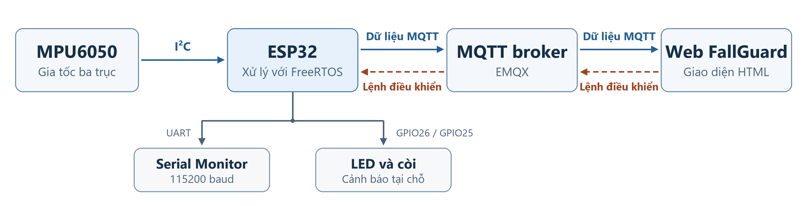
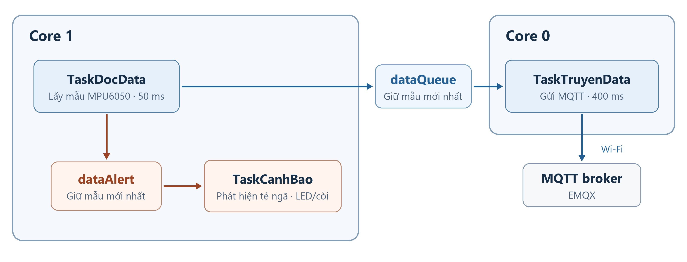
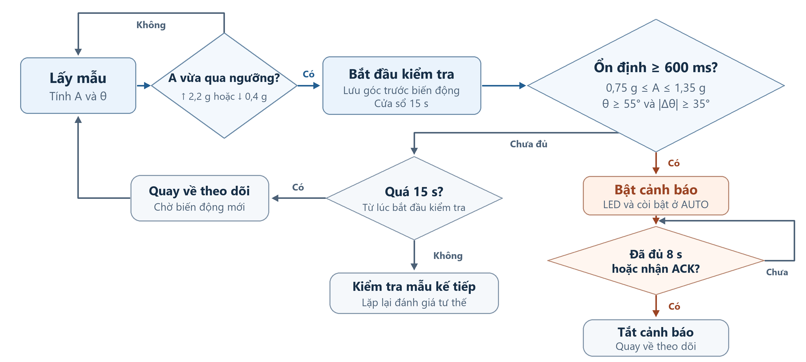

# Lab 3 – Đề 5. FallGuard
Sinh viên: Nguyễn Ngọc Thọ

MSV: 231432360

**Môn Hệ thống nhúng** · Thiết kế mạch phát hiện té ngã dùng ESP32, MPU6050, FreeRTOS và MQTT.

- [Mở dự án mô phỏng trên Wokwi](https://wokwi.com/projects/477918510824406017)
- [Xem mã ESP32](wokwi/sketch.ino)
- [Đến phần giao diện Web Dashboard](#7-giao-diện-web-dashboard)
- [Báo cáo](Bao_cao_Lab3_De5_NguyenNgocTho.pdf)

## 1. Yêu cầu bài toán

ESP32 đọc gia tốc từ MPU6050, tính góc nghiêng, in kết quả qua Serial và gửi số liệu lên MQTT broker. Web hiển thị giá trị đo, hai biểu đồ theo thời gian và hai nút điều khiển LED, còi trong chế độ MANUAL.

## 2. Kiến trúc hệ thống

ESP32 lấy mẫu qua I²C, xử lý cảnh báo tại chỗ và gửi dữ liệu đến web qua broker EMQX. Lệnh điều khiển đi theo chiều ngược lại từ web về ESP32.

## 3. Mạch mô phỏng Wokwi

[Xem sơ đồ mạch trên Wokwi](https://wokwi.com/projects/477918510824406017) hoặc đọc cấu hình [diagram.json](wokwi/diagram.json).

| Linh kiện | Kết nối |
| --- | --- |
| MPU6050 | SDA → GPIO21, SCL → GPIO22, VCC → 3V3, GND và AD0 → GND |
| LED đỏ | GPIO26 → điện trở 220 Ω → anode LED, cathode → GND |
| Còi piezo | Chân 2 → GPIO25, chân 1 → GND |
| Serial Monitor | 115200 baud |

## 4. Tổ chức FreeRTOS

| Tác vụ | Lõi | Chức năng |
| --- | --- | --- |
| `TaskDocData` | Core 1 | Lấy mẫu mỗi 50 ms, tính gia tốc tổng và góc nghiêng, in Serial, ghi vào `dataQueue` và `dataAlert`. |
| `TaskCanhBao` | Core 1 | Đọc `dataAlert`, chạy bộ phát hiện, điều khiển LED và còi. |
| `TaskTruyenData` | Core 0 | Kết nối Wi-Fi và MQTT, gửi mẫu mới nhất từ `dataQueue` theo chu kỳ mục tiêu 400 ms khi có kết nối. |

Hai hàng đợi dữ liệu giữ một mẫu mới nhất. Trạng thái dùng chung giữa các tác vụ được bảo vệ bằng mutex.

## 5. Thuật toán phát hiện

Bộ phát hiện mở cửa sổ theo dõi khoảng 15 giây khi gia tốc tổng tăng qua 2,2 g hoặc giảm dưới 0,4 g. Cảnh báo được xác nhận khi gia tốc nằm trong khoảng 0,75–1,35 g, góc nghiêng đạt ít nhất 55° và chênh lệch góc so với trước biến động đạt ít nhất 35° liên tục trong 600 ms. Ở AUTO, LED và còi bật khi có cảnh báo. Cảnh báo kết thúc sau khoảng 8 giây hoặc khi nhận ACK.

## 6. Giao tiếp MQTT

| Thành phần | Giá trị |
| --- | --- |
| ESP32 | `broker.emqx.io:1883` |
| Trình duyệt | `wss://broker.emqx.io:8084/mqtt` |
| Topic gốc | `fd-demo-81472` |
| Telemetry | `fd-demo-81472/telemetry` |
| Lệnh | Hậu tố `/cmd/mode`, `/cmd/led`, `/cmd/buzzer`, `/cmd/simulate`, `/cmd/reset` |

## 7. Giao diện Web Dashboard

Dashboard hiển thị Ax, Ay, Az, gia tốc tổng và góc nghiêng, cùng hai biểu đồ theo thời gian. Khi phát hiện té ngã, web hiển thị cảnh báo đỏ và phát chuỗi còi ba nhịp. Hai nút LED/còi gửi lệnh đến ESP32 khi chọn MANUAL và thiết bị trực tuyến.

- **Mô phỏng Web**. Mở [index.html](index.html) bằng trình duyệt, chọn kịch bản và nhấn **Bắt đầu mô phỏng Web**. Tệp HTML có thể tải bằng nút **Download raw file** trên GitHub.
- **Web liên kết Wokwi**. Chạy [dự án Wokwi](https://wokwi.com/projects/477918510824406017), đợi Serial hiện `[MQTT C0] Connected / subscribed`, rồi chọn **Web liên kết Wokwi** trên dashboard. Khi ESP32 trực tuyến, có thể chọn **MANUAL** để thử LED/còi hoặc chạy **Bắt đầu Web + Wokwi** để thử kịch bản té ngã.
- Nếu Wokwi báo lỗi IoT Gateway, dùng nguồn **Mô phỏng Web** để trình diễn giao diện và dùng Serial Monitor để quan sát dữ liệu cảm biến tại chỗ.

### Video mô phỏng té ngã

https://github.com/user-attachments/assets/4fce6b2c-43d4-40fc-9861-34582a79e238

## 8. Kết quả kiểm thử mô phỏng

| Kịch bản | Kết quả quan sát |
| --- | --- |
| MPU6050 đứng yên | Ax = 0 g, Ay = 0 g, Az = 1 g, gia tốc tổng = 1 g, góc nghiêng = 0°. |
| Kịch bản té ngã tổng hợp trên ESP32 | Xác nhận cảnh báo ở khoảng 1,04 g và 73,3°. Dashboard hiển thị cảnh báo, LED/còi bật ở AUTO. |
| Điều khiển MANUAL | ESP32 nhận lệnh LED và còi riêng. Dashboard cập nhật trạng thái theo telemetry phản hồi. |

## 9. Cấu trúc mã nguồn

- [`index.html`](index.html) chứa dashboard, CSS, JavaScript và thư viện MQTT.js.
- [`wokwi/`](wokwi/) chứa firmware, thuật toán phát hiện, sơ đồ mạch và danh sách thư viện.
- [`images/`](images/) chứa sơ đồ khối, sơ đồ FreeRTOS và lưu đồ thuật toán.
- [`MQTT-LICENSE.txt`](MQTT-LICENSE.txt) chứa giấy phép của thư viện MQTT.js.
